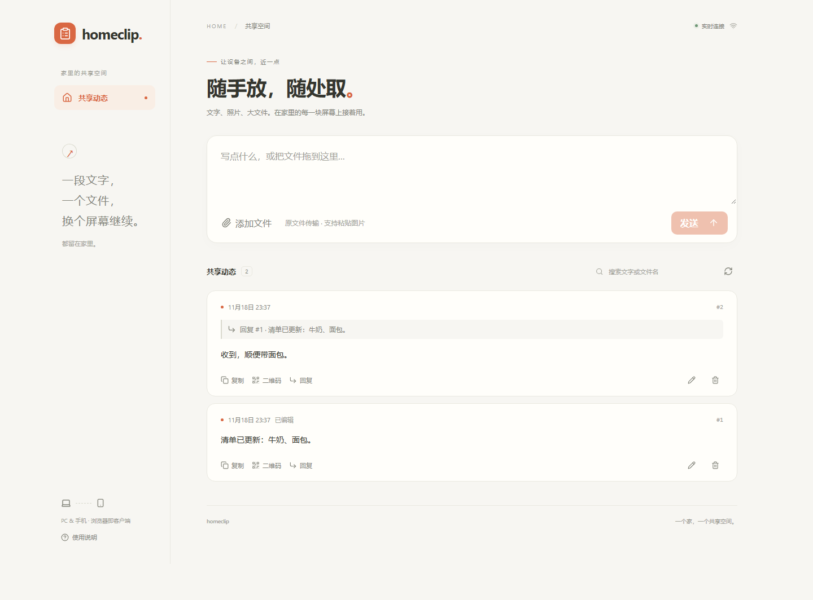

# Homeclip

家庭局域网共享消息板。在 PC 和手机浏览器之间传递文字和原始文件。
打开地址就能使用，所有客户端同步显示消息。每条消息可以包含文字、多个附件和回复引用。



[查看手机界面](docs/mobile.png)

## 功能

- 文字直接显示，保留换行和空格。支持复制、编辑、回复、删除和搜索。
- 点击文字消息的“二维码”，用手机扫描原文。超出二维码容量时给出提示。
- 文件按 8 MiB 分片上传，支持暂停、继续和失败重试。应用不设附件总大小上限。
- 支持拖放文件、粘贴图片和多文件上传。
- 图片、视频和音频使用浏览器原生预览，保持原文件，不压缩或转码。
- 文本文件按 64 KiB 分段查看，支持 UTF-8、GB18030 和 UTF-16。
- 下载支持 HTTP Range、断点续传和原始文件名。文件信息显示 SHA-256。
- 历史消息每页最多 40 条。断线重连和页面重新激活时补齐变化。

项目面向家庭局域网，没有账户、登录和权限系统。
前端资源随镜像提供，运行时不访问 CDN 或其他外部服务。

## Docker 部署

在开发机上构建 Linux amd64 镜像：

```sh
docker build --platform linux/amd64 -t homeclip:latest .
```

最终镜像使用 `scratch`，只包含静态链接的 Rust 程序和前端文件。
SQLite 随程序静态链接。运行时不需要 Node.js、系统 libc 或 shell。

如果在另一台机器运行，先导出镜像并传到服务器：

```sh
docker save -o homeclip-linux-amd64.tar homeclip:latest
```

在服务器加载镜像，把仓库中的 `compose.yaml` 放入部署目录，然后启动：

```sh
docker load -i homeclip-linux-amd64.tar
docker compose up -d
```

打开 `http://服务器地址:8080`。数据保存在 `compose.yaml` 旁的 `data` 目录。
也可以直接运行：

```sh
docker run -d --name homeclip --restart unless-stopped \
  -p 8080:8080 -v /你的绝对路径/homeclip-data:/data homeclip:latest
```

修改 `compose.yaml` 的端口映射即可更换对外端口，例如 `8090:8080`。
镜像自带健康检查，`docker ps` 会显示健康状态。

## 数据与资源使用

挂载目录中有 `homeclip.sqlite3`、SQLite 的 WAL 文件和 `files/` 原文件目录。
使用本地磁盘目录。备份时先停止容器，再完整复制挂载目录；恢复时挂载这份副本。

上传请求直接写盘，服务器最多同时处理 4 个分片，网页最多同时上传 2 个文件。
上传完成后，单个后台任务顺序读取原文件并计算 SHA-256。
这会多读一遍磁盘，但无需把文件装入内存。
下载也使用固定缓冲。文件大小主要影响磁盘空间和传输时间。

本机 Docker Desktop 的一次验证：镜像约 5.11 MiB，空闲进程 RSS 约 4.50 MiB。
在 128 MiB 容器内存限制下传输 256 MiB 文件，采样最高进程 RSS 约 5.27 MiB。
RSS 不包含磁盘页缓存。J4125 上的吞吐量需结合实际磁盘和网络测量。

上传进度保存在 SQLite。服务器重启后，仍打开的网页可以继续上传。
刷新或关闭网页会丢失尚未发送的附件队列，需要重新选择文件；文字草稿保留在当前浏览器。
未发送的上传不会自动过期，可用上传取消接口删除。

删除消息时会一并删除附件。暂时无法删除的磁盘文件进入清理队列，服务器启动时及每分钟重试。
文字消息使用 JSON 接口，请求体上限为 2 MiB；这个限制不影响附件大小。

浏览器是否支持某种图片或音视频格式，由浏览器决定。无法预览时可直接保存。
普通局域网 HTTP 下，一键复制会尝试兼容方式；浏览器拒绝时显示可选中的文字。
扫码后的复制操作由手机扫码工具提供。

## 本地开发

需要 Rust stable、npm 和 Node.js 22.12 或更新版本。

```sh
npm --prefix web ci
npm --prefix web run build
cargo run
```

打开 `http://localhost:8080`。开发数据默认写入当前目录下的 `data/`。
前端热更新另开终端执行 `npm --prefix web run dev`，Vite 会把 `/api` 转发到本地 8080 端口。

| 环境变量 | 默认值 | 用途 |
| --- | --- | --- |
| `HOMECLIP_BIND` | `0.0.0.0:8080` | HTTP 监听地址 |
| `HOMECLIP_DATA` | `data` | SQLite 和附件目录，容器中为 `/data` |
| `HOMECLIP_WEB` | `web/dist` | 前端构建目录，容器中为 `/web` |
| `RUST_LOG` | `homeclip=info` | 日志过滤规则 |

后端使用 Rust、Axum、Tokio 和 rusqlite。前端使用 Vue 3 Composition API 和 TypeScript。
消息通知使用 SSE，消息与事件在同一个 SQLite 事务中提交。
文件内容单独落盘。接口说明见 [docs/api.md](docs/api.md)。

## 验证

```sh
cargo fmt --check
cargo clippy --all-targets --all-features -- -D warnings
cargo test
npm --prefix web run build
cd web
npx playwright install chromium
npm test
```

浏览器测试自动启动独立的本地 debug 服务，分别检查桌面和手机尺寸的界面。
测试数据写入 `.local/`，不使用日常运行的 `data/`。

镜像构建后，在项目根目录运行：

```sh
node scripts/verify-image.mjs homeclip:latest
```

这个检查会启动临时容器，限制其内存为 128 MiB，传输 256 MiB 文件，验证重启恢复、摘要、Range 下载和 SIGTERM 退出。
结果写入 `.local/image-check.json`。测试只清理自己创建的容器和临时目录。

## 许可证

MIT，见 [LICENSE](LICENSE)。
